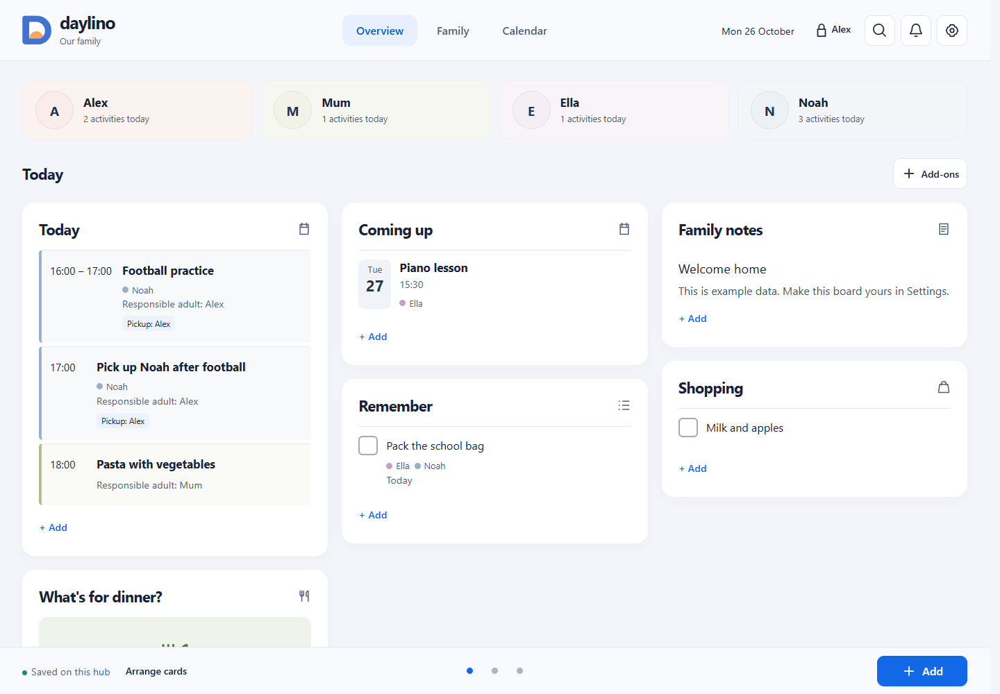

# Daylino — Windows Family Hub

Keep your family's plans, routines and everyday tasks together on your own Windows computer. Daylino includes Danish and English, with on-screen mouse and touch controls.

[**Download Daylino 0.7.0 for Windows x64**](https://github.com/MiMat82/Daylino-Releases/releases/download/v0.7.0/Daylino-0.7.0-win-x64-Setup.exe) · [**Screenshots, features, instructions and changes**](https://github.com/MiMat82/Daylino-Releases/releases/tag/v0.7.0)

## Included

- Shared Overview, individual family timetables and a monthly calendar.
- Plans, repetitions, meals, notes, tasks, shopping and transport arrangements.
- Visual routines, child activity requests and guardian-controlled editing.
- Previewed local `.ics` calendar import, backups, search and item recovery.
- Signed Windows update downloads with guardian installation and recovery copies.
- Local household data and offline family features; no account or subscription required.

This preview runs on one Windows x64 computer. Phone connectivity, mobile apps and two-way calendar synchronization are not included. Optional cards shown in the screenshot can be enabled in Settings; a new household starts with Today and Coming up.

## Install and update

For a first installation, download and run the Setup EXE, then follow the household wizard.

To update from 0.6.1 or earlier, export a backup, use **Settings → Quit Daylino**, then run the 0.7.0 installer under the same Windows user. Existing household data is retained. Check **Settings → About** afterward to confirm **0.7.0**. This one-time installation enables the updater for later releases.

Once a complete required update is downloaded and verified, a guardian must select **Update now** before normal use continues. Recovery backup and Quit remain available.

Read the [full release guide](https://github.com/MiMat82/Daylino-Releases/releases/tag/v0.7.0) for illustrated instructions, exactly what changed, update behavior, checksums and preview limits. The installer includes its runtime. GitHub's automatic Source code archives are not the app installer.

## Om udgivelsen

Daylino er en lokal familiehub til Windows x64. Ved opdatering fra 0.6.1 eller ældre: eksportér en sikkerhedskopi, afslut hubben under **Indstillinger → Afslut Daylino**, og kør installationsprogrammet under samme Windows-bruger. Kontrollér versionen under **Indstillinger → Om Daylino**.
